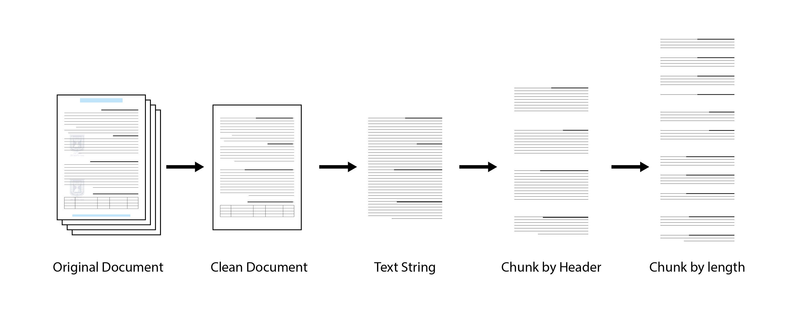
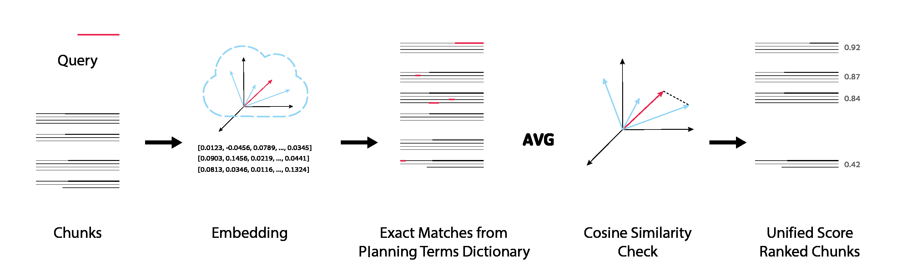
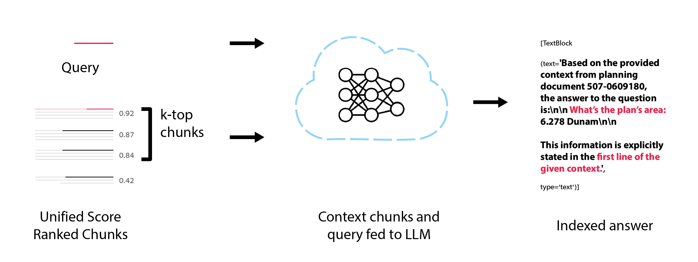
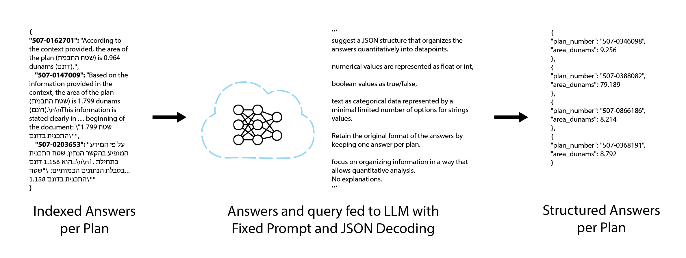
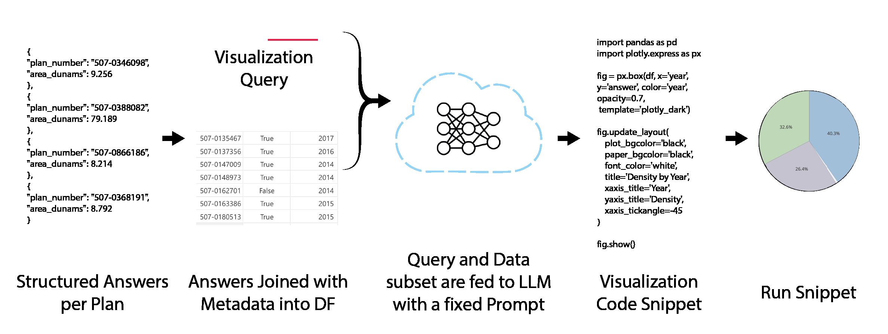
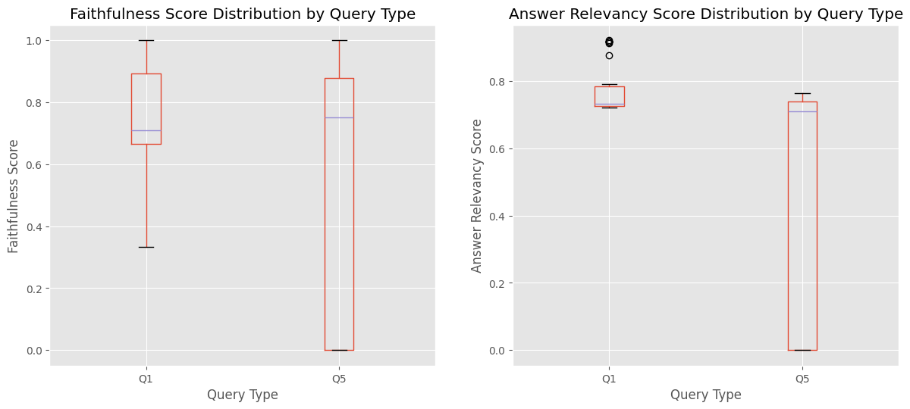
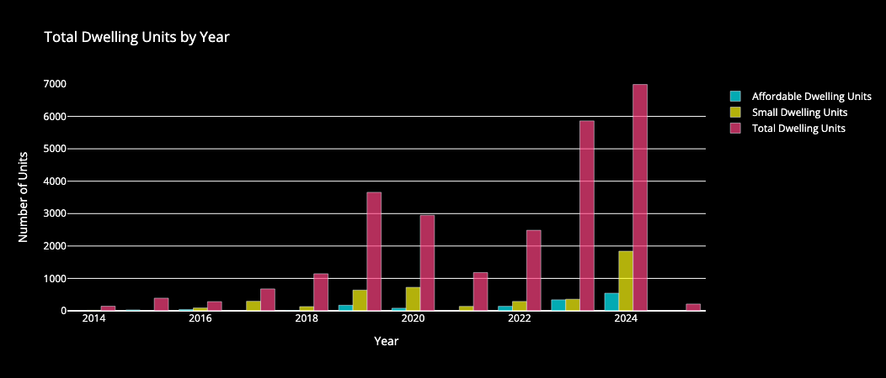

# RAG-Planning

A system for extracting, structuring, and visualizing data from municipal planning documents, built on LLM APIs (Claude and GPT).

**85% accuracy on 40 hand-labeled plans · all 144 Tel Aviv master plans processed in ~5 minutes (vs. ~6 workdays by hand) · validated with 6 urban planners**

## Pipeline

**1. Preprocessing**: clean the PDF, extract text, chunk by header, then by length.



**2. Hybrid retrieval**: embedding similarity averaged with exact matches from a planning-terms dictionary, so domain jargon isn't missed.



**3. Answer generation**: the top-k chunks and the query go to Claude, which returns an answer with its source.



**4. Structuring**: answers go to GPT-4o with a fixed prompt and JSON decoding, producing typed data per plan (boolean, categorical, integer, float).



**5. Visualization**: structured data is joined with plan metadata, Claude writes Plotly code, and the code runs.



## Results

| Metric | Result |
|---|---|
| End-to-end accuracy (40 hand-labeled plans, 12 questions) | **85.45%** average |
| Simple fields (plan area, plan type, reparcellation) | 100% |
| Hardest fields (e.g. small-unit area limits) | ~65% |
| Processing time, all 144 plans | **5 min 15 s** (vs. ~20 min per plan by hand, ~6 workdays total) |
| RAGAS (LLM-as-judge, 80 samples) | Faithfulness 0.66 · Relevancy 0.58 · Correctness 0.52 |

Evaluated with a manually labeled golden set (`PythonNotebooks/Evaluation/ground_truth_retrieval.json`) and [RAGAS](https://docs.ragas.io/). Validated in workshops with 6 urban planners (5 from the Tel Aviv municipality).



Q5 (number of housing units) clusters at 0 where the source didn't state the value. The model answered anyway instead of abstaining, which is why explicit "not stated" handling is the first item in the failure analysis below.



## What I learned (failure analysis)

- **Hallucinated numbers** when the answer isn't in the document → needs explicit abstention ("not stated").
- **Arithmetic errors** → calculations should run in code, not in the LLM.
- **Category confusion** ("very small" units counted as "small") → define categories in the prompt and schema.
- **Inconsistent output keys** across calls → enforce a strict JSON schema.
- **Unreliable generated visualizations** → use chart templates instead of free-form code generation.

## Next steps

Answer provenance and citations, regression runs on the golden set for every model or prompt change, and support for scanned documents and GIS data.

## Running it

These notebooks work best with Python 3.9.6. All required libraries and their recommended versions are in `requirements.txt`:

```
pip install -r requirements.txt
```

API keys (Voyage AI, Anthropic, OpenAI) are read from a local `.env` file, which is not committed.

The `PythonNotebooks` folder contains 3 notebooks, one per stage:

1. **RAG.ipynb**: embeds the planning instructions documents (הוראות) with the Voyage AI API, saves them to a local vector DB, and queries each plan with Claude (Sonnet 3.7).
2. **Structuring.ipynb**: uses the GPT API to turn the generated answers into queryable JSON (boolean / categorical / integer / float).
3. **SemiFormal.ipynb**: joins the structured data with plan metadata (approval year), uses Claude to generate visualization code, and runs it to produce interactive Plotly charts.

## Data

Planning documents under the local authority of the Tel Aviv municipality. All are available as open data from the national planning authority: https://mavat.iplan.gov.il/
