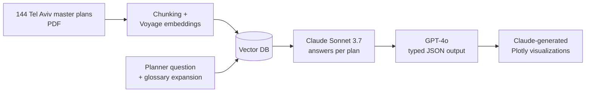

# RAG-Planning
A system for extracting, structuring, and visualizing data from municipal planning document. Using proprietary APIs (Claude and GPT)

## Environment
These notebooks work best with Python version 3.9.6
You can find under requirements.txt all necessary libraries and their recommended versions.

To recreate the virtual environment: 

*pip install -r requirements.txt*

## Files Structure
The PythonNotebooks folder contains the 3 notebooks to run manually the 3 stages of the system:

  (1) RAG - Embedding the original data (pdf planning instructions - הוראות - documents) using Voyage AI API, saving them to a local DB, and then using Claude (Sonnet-3.7) API to query them one by one. 
  
  (2) Structuring - Using GPT API to structure the generated answers from the RAG stage, into JSONs that can be queried (Boolean/Categorical data/Interger/Float). 
  
  (3) SemiFormal - Joining the strucutred data to the metadata (years in which the planning documents were created), using Claude API to produce code snippet for visualizing the data, and running them to produce interactive Plotly visualizations. 

## DATA 
Data to use the system include planning documents under local authority of Tel Aviv municipality. All planning documents can be accessed as open data through the governmental website of the planning authority: https://mavat.iplan.gov.il/

## Pipeline

## Results

| Metric | Result |
|---|---|
| End-to-end accuracy (40 hand-labeled plans, 12 questions) | **85.45%** average |
| Simple fields (plan area, plan type, reparcellation) | 100% |
| Hardest fields (e.g. small-unit area limits) | ~65% |
| Processing time, all 144 plans | **5 min 15 s** (vs. ~20 min per plan by hand, ~6 workdays total) |
| RAGAS (LLM-as-judge, 80 samples) | Faithfulness 0.66 · Relevancy 0.58 · Correctness 0.52 |

Evaluated with a manually labeled golden set (`Evaluation/ground_truth_retrieval.json`) and [RAGAS](https://docs.ragas.io/). Validated in workshops with 6 urban planners (5 from the Tel Aviv municipality).

## What I learned (failure analysis)

- **Hallucinated numbers** when the answer isn't in the document → needs explicit abstention ("not stated").
- **Arithmetic errors** → calculations should run in code, not in the LLM.
- **Category confusion** ("very small" units counted as "small") → define categories in the prompt and schema.
- **Inconsistent output keys** across calls → enforce a strict JSON schema.
- **Unreliable generated visualizations** → use chart templates instead of free-form code generation.

## Next steps

Answer provenance and citations, regression runs on the golden set for every model or prompt change, and support for scanned documents and GIS data.
